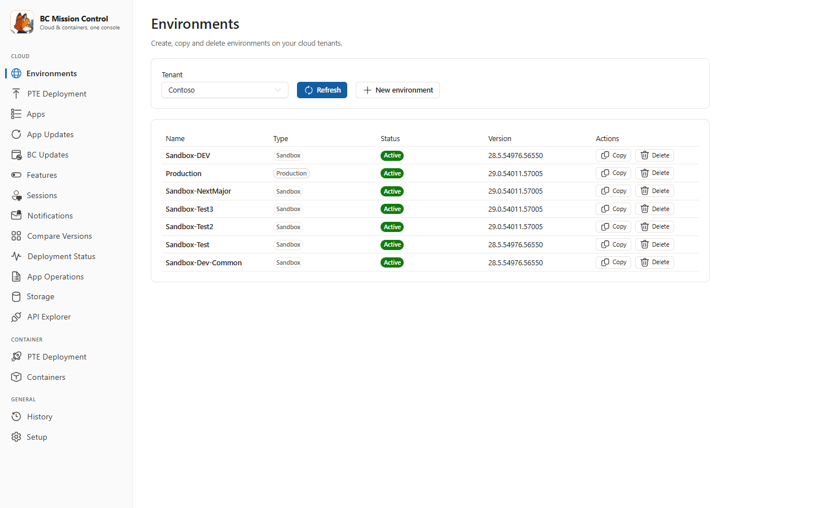

# BC Mission Control

[](LICENSE)


A fast, local web UI for managing Business Central — cloud (SaaS) tenants and
local Docker containers from one place. The Node backend talks to the Business
Central Admin Center and Automation APIs directly; no scripts to run by hand.

Built by [Teddy Herryanto](https://thatnavguy.com).



**New here? Read the [User Guide](docs/UserGuide.md)** — step-by-step
instructions with screenshots for every page.

## Features

- **Setup page** — one device code sign-in covers everything (no client secret
  needed). Client ID is optional: leave blank to use the built-in shared
  Microsoft registration, or enter your own multi-tenant Entra ID app. Manage
  tenants and tick which environments are enabled as targets.
- **Environments page** — list environments with type, status, and version.
  Create new environments (name/type/country), copy an active environment to
  a new sandbox, or delete (soft delete — recoverable for 14 days) with
  live progress tracked in History.
- **PTE Deployment page** — drag & drop `.app` files (manifest is read
  automatically), select tenant/environment targets, choose **Immediate** or
  **Update window** scheduling, schema sync mode, and deploy with live
  per-target progress. Apps deploy in dependency order.
- **Apps page** — browse extensions in an environment with scope badges
  (PTE / Dev / AppSource). Reinstall uninstalled PTEs, unpublish old PTE
  versions, and apply AppSource updates — all from one table. Manual Refresh;
  nothing is fetched until you ask.
- **App Updates page** — check an environment for available AppSource updates,
  then apply them now (with live progress) or schedule them into the update
  window. Dependencies are handled automatically.
- **BC Updates page** — upcoming platform versions per environment with
  release and rollout status. Select the target version (optionally with a
  date) and edit the maintenance window (start/end time + time zone).
- **Sessions page** — active sessions per environment (user, client type,
  current object, operation duration) with one-click disconnect after
  confirmation.
- **Compare Versions page** — pick which tenants/environments to scan, then
  compare installed versions in a matrix with drift detection
  (✓ Same / ✗ Different) and the latest version highlighted.
- **App Operations page** — audit log of app installs, updates, uninstalls,
  and hotfixes per environment, with actor, error details, and period/type
  filters.
- **Storage page** — database usage per environment against the tenant quota
  (base + licenses + add-ons), plus environment counts vs limits.
- **Deployment Status page** — latest extension deployment operations per
  environment, including error messages. Manual Refresh.
- **API Explorer page** — call any BC API endpoint (standard v2.0, custom APIs,
  automation API) with tenant/environment/company pickers and a formatted
  response viewer. Runs as your signed-in user.
- **History page** — every run (cloud deploy, app update, environment
  create/copy/delete, container work) with per-target results and a full log.

### Container section (requires Docker + PowerShell 7 + BcContainerHelper)

- **PTE Deployment** — deploy staged `.app` files to local BC containers
  (publish + sync + install/upgrade) with live per-container progress.
- **Containers** — map friendly names to Docker containers with live status,
  save defaults (license file, DNS, country, memory limit) once, and create
  new containers via a form (artifact type/country/version, credentials,
  toolkits) with streamed creation output.

## Architecture

Product and design context live in `PRODUCT.md` (what the product is and who
it serves) and `DESIGN.md` (the visual system: tokens, surfaces, rules).

```
server/   Express + TypeScript backend (port 4321)
          - OAuth2 device code flow against login.microsoftonline.com
          - Admin Center API  v2.29  (environments, app updates, platform
                                     updates, sessions, storage, PTE install)
          - Automation API    v2.0   (extension upload, install/unpublish, status)
          - container actions spawn local pwsh + BcContainerHelper
web/      React + TypeScript + Vite + Fluent UI (port 5173 in dev)
```

Data (settings, token, uploaded apps) lives in `server/data/` — keep it private.

## Prerequisites

- [Node.js](https://nodejs.org/en/download) 18 or later. Choose the **LTS
  (Long Term Support)** version. The installer includes npm.
- That's it for cloud. A custom Entra ID app registration is **optional**.
- Container section additionally needs: Docker Desktop, PowerShell 7 (`pwsh`),
  and `Install-Module BcContainerHelper`.

## Getting Started

1. Get the code:

   ```powershell
   git clone https://github.com/thatnavguy/BC-Mission-Control.git
   cd BC-Mission-Control
   ```

   Or use **Code → Download ZIP** on GitHub and extract it.

2. **Double-click `Start-MissionControl.bat`** — it installs dependencies and builds
   on first run, starts the server, and opens http://127.0.0.1:4321 in your browser.
   Keep the console window open while using the app.

3. In the app, open **Setup** and click **Sign in with device code**
   (optionally paste your own Client ID first).

4. Add a tenant (name + tenant ID), click **Load environments**, tick the
   environments you work with. Soft-deleted environments are hidden.

5. Go to **PTE Deployment**, drop your `.app` files, pick targets, deploy.

For a desktop shortcut, run `Create-DesktopShortcut.ps1` once
(right-click → Run with PowerShell).

Prefer the terminal? Use these instead of `Start-MissionControl.bat`:

```powershell
npm run setup     # first time: install dependencies
npm start         # build web + server, serve everything at http://127.0.0.1:4321
```

Development mode (hot reload):

```powershell
npm run dev:server   # terminal 1 — API on 4321
npm run dev:web      # terminal 2 — UI on 5173 (proxies /api to 4321)
```

## License

[MIT](LICENSE) — © 2026 [Teddy Herryanto](https://thatnavguy.com).
