# BC Mission Control — User Guide

This guide shows you how to install, sign in, and use every page of BC Mission
Control — a local web app for managing Business Central (BC) cloud tenants and
local Docker containers from one place.

---

## What BC Mission Control does

BC Mission Control is a web page that runs on your own computer. It lets you:

- Create, copy, and delete cloud environments.
- Deploy apps (`.app` files) to cloud sandboxes and production environments.
- See which app versions are installed in each environment.
- Find and apply AppSource app updates.
- See scheduled BC platform updates and set the maintenance window.
- Turn Business Central features on or off in an environment.
- See who is signed in to an environment and end stuck sessions.
- Manage who gets email notifications about environment updates.
- Review the app operations history of an environment.
- Compare versions across environments to spot differences.
- Check database storage use against your tenant quota.
- Call BC APIs directly from your browser.
- Create local Docker containers and deploy apps to them.

Nothing is sent to a third party. The app talks to Microsoft's Business Central
APIs directly, using your own sign-in.

---

## Start the app

### Download and run the EXE (recommended)

You do not need to install Node.js or download the source code.

1. Download **`BCMissionControl.exe`** from the
   [latest release](https://github.com/thatnavguy/BC-Mission-Control/releases/latest).
2. Save it in a folder where you want to keep the app.
3. Double-click **`BCMissionControl.exe`**.

Your browser opens at `http://127.0.0.1:7654`, unless you have saved a different
port in Setup.

Keep the console window open while you use the app. Close it to stop the app.

Windows SmartScreen may show a warning because the EXE is not code-signed.
Only proceed if you downloaded it from this project's GitHub release page
and trust the file. Select **More info**, then **Run anyway**, if Windows offers it.

For a desktop shortcut, right-click the EXE and select **Send to → Desktop
(create shortcut)**. On Windows 11, select **Show more options** first if needed.

Docker Desktop, PowerShell 7, and BcContainerHelper are still required for
container work. You do not need them for cloud-only use.

### Update the EXE

1. Close the app's console window.
2. Download **`BCMissionControl.exe`** from the latest release.
3. Replace your old EXE with the downloaded file.
4. Double-click the new EXE.

Your saved settings and sign-in are kept. Open **General → About** to check
your installed version.

### Run from source code (alternative)

Use this option if you want to work with the source code. Follow the
[source setup instructions](../README.md#option-2--run-from-source) in the README.

1. Double-click **`Start-MissionControl.bat`** in the source folder.
2. Wait for it to install dependencies and build the app on the first run.
3. Keep the console window open while you use the app.

For this option, run `Create-DesktopShortcut.ps1` once to create a desktop shortcut.

---

## Setup page — sign in and add tenants

Do this once, before anything else.

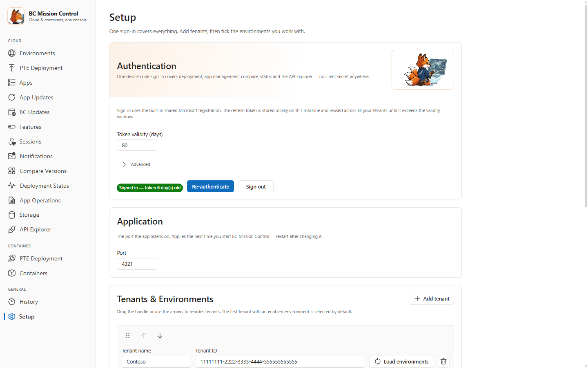

### Sign in

1. Open **Setup** (bottom of the left menu).
2. Leave **Client ID** blank to use the built-in shared Microsoft registration.
   Only enter your own Client ID if your company requires its own Entra ID app.
3. Click **Sign in with device code**.
4. A code appears. Click the link, enter the code, and sign in with your
   Microsoft work account.
5. Back in the app, you see a green **Signed in** badge.

One sign-in covers every page and every tenant. The app remembers you on this
computer until the token expires (default 80 days), then you sign in again.

### Add tenants and environments

1. Click **Add tenant**.
2. Enter a friendly **Tenant name** and the **Tenant ID** (a GUID from the BC
   Admin Center or Entra ID).
3. Click **Load environments**.
4. Tick the environments you work with. Unticked environments stay hidden from
   the rest of the app.

Soft-deleted environments are hidden automatically — the same as in the Admin
Center.

---

## Cloud section

### Environments

Create, copy, and delete environments on a tenant.

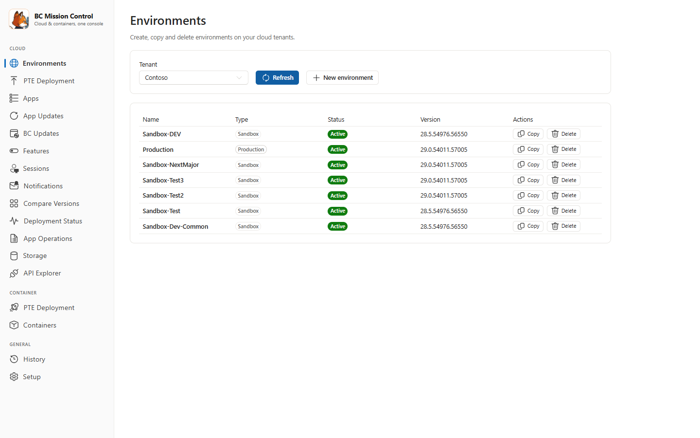

1. Pick a **Tenant** and click **Load environments**.
2. You see every environment with its type, status, and version.

From here you can:

- **New environment** — enter a name, pick **Sandbox** or **Production**, and
  choose a country. Provisioning takes a few minutes; progress shows on the
  page.
- **Copy** — make a sandbox copy of an active environment, including all its
  data. Copying can take 15 minutes or more.
- **Delete** — type the environment name to confirm. The environment is
  soft-deleted: Microsoft keeps it for 14 days, and you can recover it from
  the Admin Center during that time.

Environment names must start with a letter and use only letters, numbers,
dashes, and underscores (30 characters at most).

### PTE Deployment (cloud)

Use this page to upload your own apps (PTEs — per-tenant extensions) to cloud
environments.

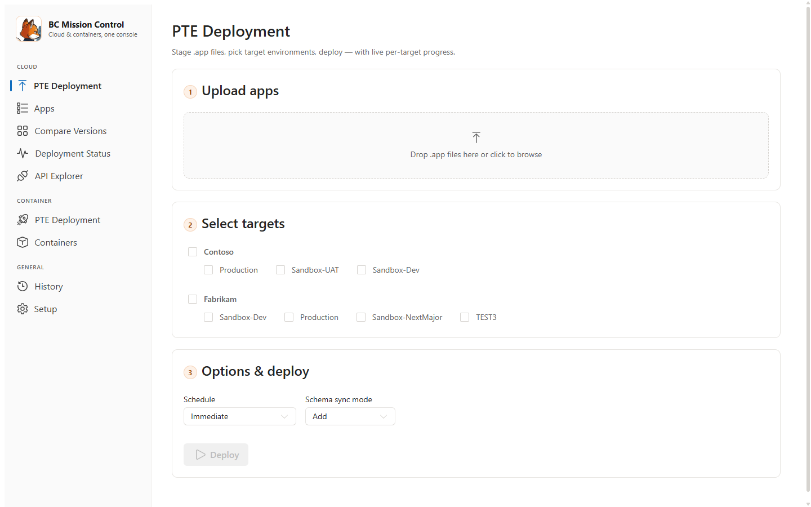

1. **Upload apps** — drag `.app` files into the box, or click it to browse. The
   app reads each file's name, publisher, and version automatically.
2. **Select targets** — tick the environments you want to deploy to.
3. **Options & deploy** — choose:
   - **Schedule**: *Immediate* installs now; *Update window* lets Microsoft
     install during the environment's maintenance window.
   - **Schema sync mode**: how table changes are applied. *Add* is the safe
     default; *Force Sync* can delete data in removed fields.
4. Click **Deploy**.

You see live progress per environment while it runs. Apps install in dependency
order automatically. Within one environment apps install one at a time;
different environments run in parallel.

### Apps

See every extension installed in one environment, with its scope
(PTE / Dev / AppSource) and state.

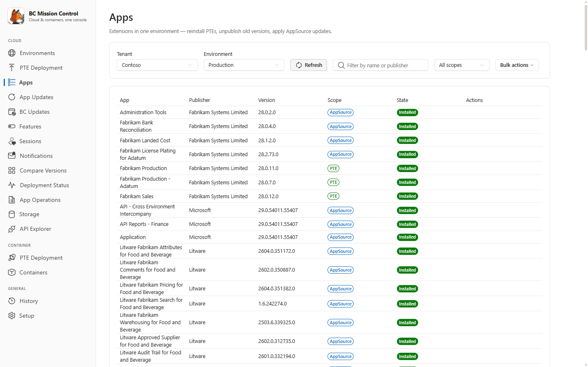

1. Pick a **Tenant** and **Environment**.
2. Click **Refresh** — nothing loads until you ask.
3. Use the filter box to find an app by name or publisher, and the scope
   dropdown to show only **AppSource**, **PTE**, or **Dev** apps. A red
   **Dev** badge marks an app published straight from Visual Studio Code —
   it bypassed the normal release process, so treat it with care.

From the **Actions** column you can:

- **Reinstall** a PTE that was uninstalled.
- **Unpublish** an old PTE version.
- **Apply update** when a newer AppSource version is available.

The **Bulk actions** menu works on many apps at once, limited to the scope
you picked in the dropdown:

- **Install all** — installs the newest published version of every app that
  is not installed yet.
- **Unpublish old versions** — removes old published versions. The newest
  version of each app and anything currently installed is kept.

Both ask for confirmation with the exact count first. Apps are handled one
at a time, and Business Central sorts out dependencies between them.
Progress shows on the page and the run is saved in **History**. Installs and
unpublishes finish in the background — check **Deployment Status** for the
final result.

### App Updates

Find and install newer AppSource (Marketplace) app versions in an environment.

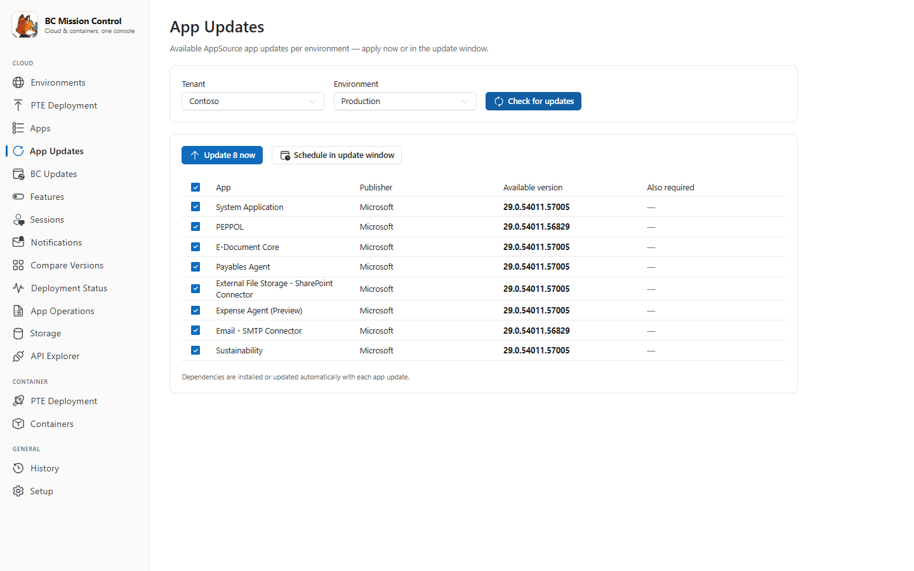

1. Pick a **Tenant** and **Environment**.
2. Click **Check for updates**.
3. Tick the apps to update. Apps that need other apps updated first show them
   in the **Also required** column — dependencies are handled automatically.
4. Choose:
   - **Update now** — installs right away and shows live progress. Users may
     be disconnected while an update installs.
   - **Schedule in update window** — Microsoft installs during the
     environment's maintenance window instead.

When everything is up to date, the page says so.

### BC Updates

See which BC platform updates are coming for an environment, choose the target
version, and set the maintenance window that updates run in.

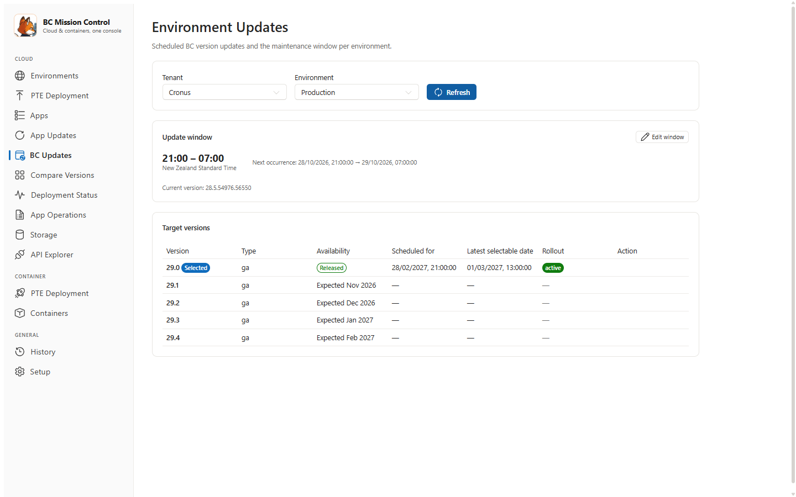

1. Pick a **Tenant** and **Environment**, then click **Load update settings**.
2. The **Update window** card shows when updates are allowed to run (for
   example 21:00–07:00 in your time zone) and the environment's current
   version.
3. Click **Edit window** to change the start time, end time, or time zone.
   The window must be at least 6 hours.
4. The **Target versions** table lists every upcoming version:
   - **Selected** marks the version the environment will update to next.
   - **Scheduled for** shows the planned date; **Latest selectable date** is
     your deadline for changing it.
5. Click **Select** on a released version to make it the target, optionally
   pick a date, and tick **Ignore the update window** to run outside the
   maintenance window.

Scheduled app installs from **App Updates** also run inside this window.

### Features

Turn Business Central features on or off in an environment — the same list
you see on the **Feature Management** page inside Business Central.

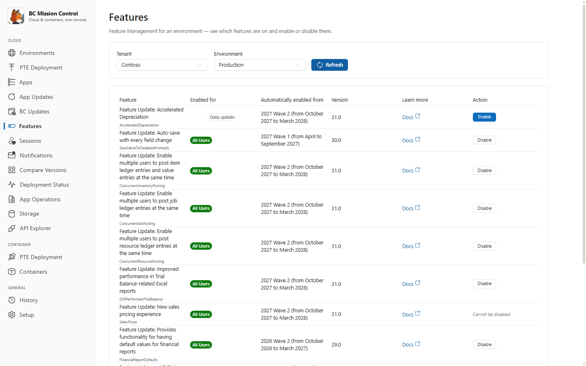

1. Pick a **Tenant** and **Environment**, then click **Load features**.
2. The table shows each feature with:
   - **Enabled for** — *All Users* or *None*.
   - **Automatically enabled from** — the update wave when Microsoft turns
     the feature on for everyone, with the version.
3. Click **Enable** or **Disable** on a feature and confirm.

Some things to know:

- A **Data update** badge means enabling the feature changes existing data.
  This runs in the background and can take a while — refresh the page after
  a few minutes to see the new state.
- Some features are one-way: once enabled, they cannot be turned off. The
  confirmation tells you when this applies, and an enabled one-way feature
  shows *Cannot be disabled*.

### Compare Versions

Check that the same apps are on the same version everywhere.

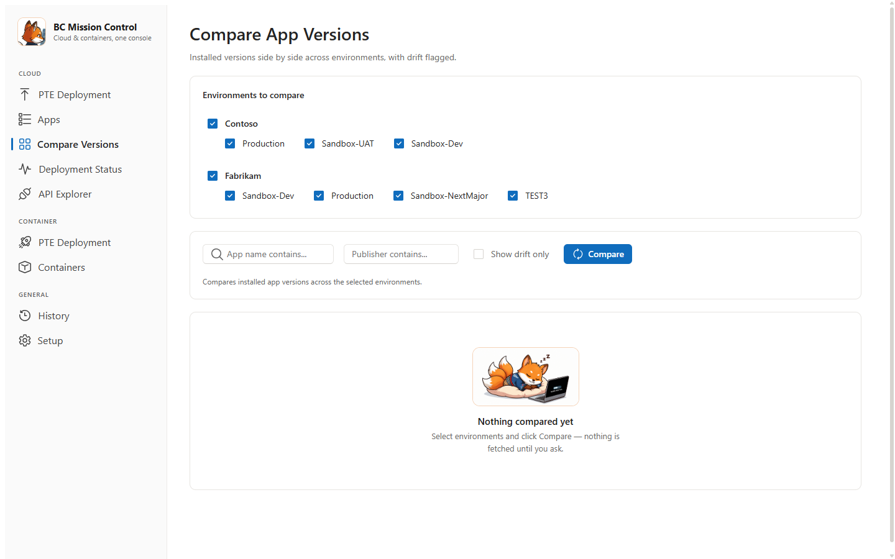

1. Tick the environments to compare.
2. Click **Compare**.
3. Read the matrix: one row per app, one column per environment.
   - ✓ means all environments match.
   - ✗ means versions differ. The highest version is highlighted.
4. Use **Show differences only** to hide apps that match everywhere. The
   name and publisher boxes filter the loaded results as you type.

### Deployment Status

See the latest app deployment operations in one environment, including error
messages when something failed.

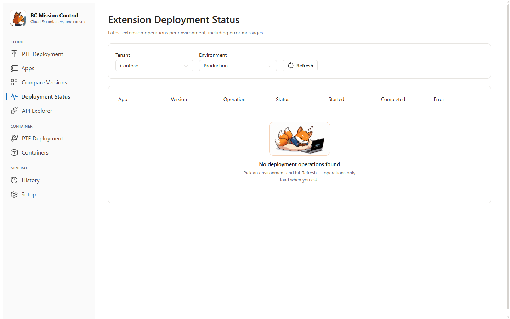

1. Pick a **Tenant** and **Environment**.
2. Click **Refresh**.
3. Check the **Status** and **Error** columns for failures.

### App Operations

See the audit log of an environment: every app install, update, uninstall, and
hotfix, with who triggered it and the error when something failed.

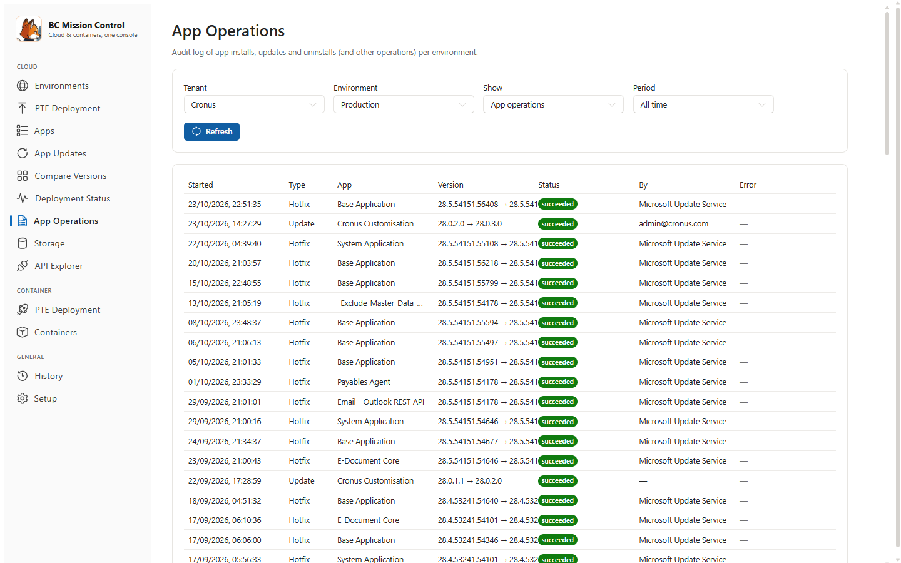

1. Pick a **Tenant** and **Environment**.
2. Click **Load operations**.
3. Use the filters:
   - **Show** — *App operations* (installs and updates only) or
     *All operations* (also environment copies, renames, and so on).
   - **Period** — last 24 hours, 7 days, 30 days, or all time.

Hover a shortened value to see it in full.

### Storage

Check database storage use against your tenant quota.

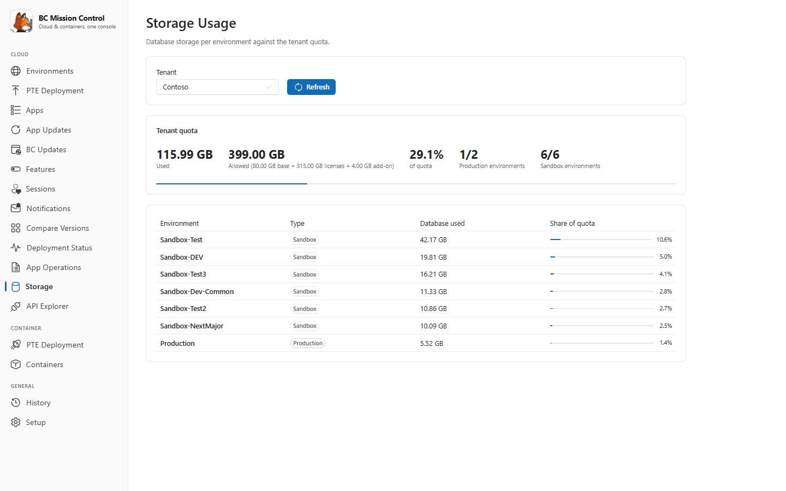

1. Pick a **Tenant** and click **Load storage usage**.
2. The top card shows total use, the allowance (base + licenses + add-ons),
   and how many environments you have compared with your limits.
3. The table lists each environment's database size and share of the quota.
   Bars turn amber over 75% and red over 90%.

If you are over quota, Microsoft blocks creating new environments until you
free space or buy more capacity.

### Sessions

See who is connected to an environment right now, and disconnect a session
when you need to — for example before a deployment or when a session is
stuck.

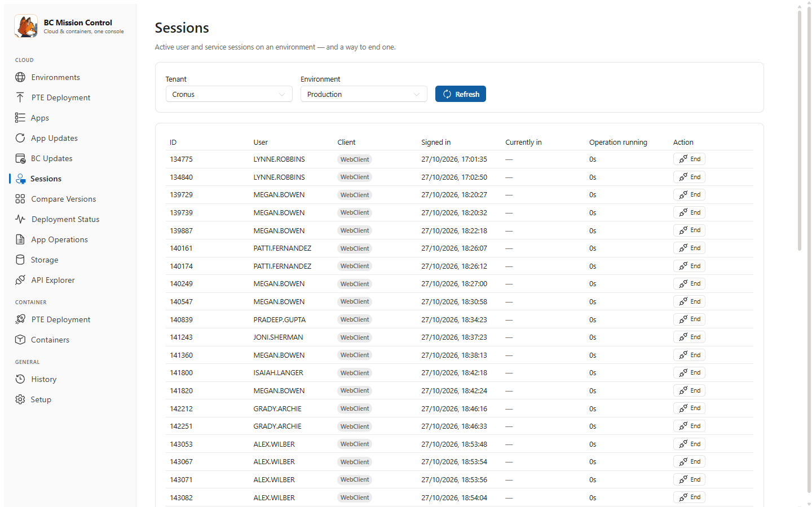

1. Pick a **Tenant** and **Environment**, then click **Load sessions**.
2. The table lists every active session:
   - **Client** — WebClient (a person in the browser), WebService
     (an integration), or a background task.
   - **Currently in** and **Operation running** — what the session is doing
     and for how long.
3. Click **End** next to a session and confirm to disconnect it.

> **Warning:** Ending a session throws the user out immediately. Unsaved work
> in that session is lost.

### Notifications

Choose who gets email notifications about environment updates and events.
Recipients are set per tenant, not per environment.

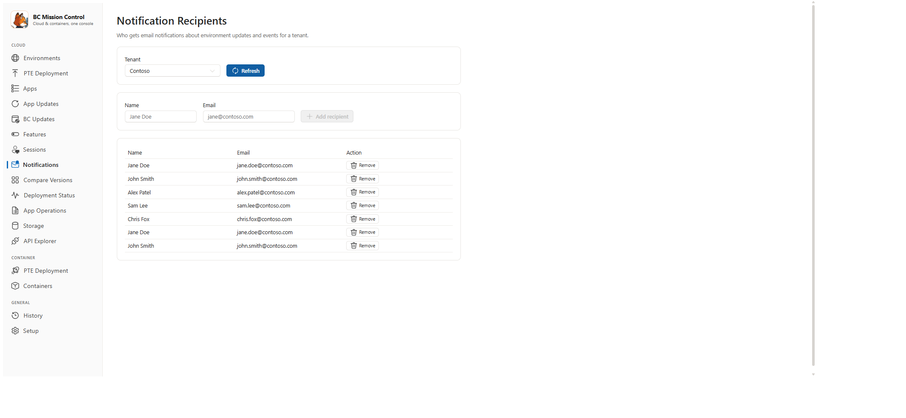

1. Pick a **Tenant**, then click **Load recipients**.
2. To add someone, enter their **Name** and **Email**, then click
   **Add recipient**.
3. To stop someone's emails, click **Remove** next to them and confirm.

### API Explorer

Call any BC API endpoint and see the raw response — handy for checking data
without opening Postman.

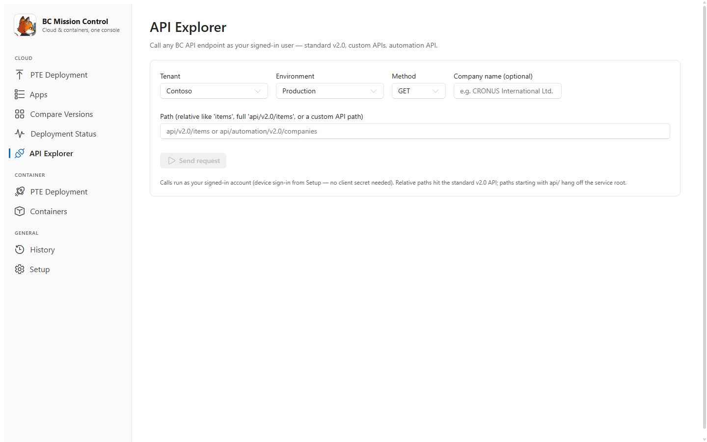

1. Pick a **Tenant** and **Environment**.
2. Choose **Microsoft** under **API type**, then select a **Microsoft API**.
   Search by name, endpoint (for example, `purchaseInvoices`), or area.
   These use Microsoft's standard v2.0 API.
3. For any preset except Companies, click **Load companies**, then select a
   **Company**. Changing the tenant or environment clears this selection.
4. Click **Send request**. The formatted response appears below.

The read-only **Request path** shows the path for your selection.
Selecting an API prepares a GET request. It does not send it or load companies
automatically. Available APIs depend on the environment's Business Central version
and your permissions.

The selector groups 31 APIs by area:

| Area | APIs |
|---|---|
| Company setup | Companies, Company Information, Currencies, Countries/Regions |
| Finance | Accounts, General Ledger Entries, Journals, Journal Lines, Dimensions, Dimension Values |
| Sales | Customers, Sales Invoices, Sales Orders, Sales Quotes, Sales Credit Memos, Sales Shipments |
| Purchasing | Vendors, Purchase Orders, Purchase Invoices, Purchase Credit Memos, Purchase Receipts |
| Inventory | Items, Locations, Item Categories, Units of Measure, Item Ledger Entries |
| Payment setup | Payment Terms, Payment Methods, Bank Accounts |
| People | Contacts, Employees |

**Journal Lines** also needs a **Journal ID**. First request Journals for the
company and copy the journal's `id`. The generated path includes that journal.

**Change Log Entries** is not in this Microsoft preset catalog or the supplied
BC29 API list. If an extension exposes it as a custom API, use Custom mode with
that endpoint. A published OData service can also be called using its full URL.

For other APIs, choose **Custom** under **API type**, choose the **Method**, and
choose a **Request type**:

- **Relative path:** choose Tenant and Environment, then enter the Path.
- **Full URL:** paste an HTTPS Business Central URL containing
  `/v2.0/{tenantId}/{environment}/api/...` or `/ODataV4/...`. Tenant and
  Environment selectors are hidden. The URL's tenant is used for authentication.
  Use a tenant GUID or domain name; URLs that omit the tenant are not supported.
  Include any company ID or query parameter in the URL itself. The separate
  company field is hidden and its saved value is not applied.

Each mode keeps its own request fields when you switch.
A path such as `api/v2.0/companies(<companyId>)/items` requests items from a
specific company. Short paths such as `companies` use the standard v2.0 API.
Custom API paths start with `api/<publisher>/<group>/<version>/`.
For Relative path only, under **Additional options**, the optional **Company ID or name** field adds a
`company` query parameter. The section is collapsed by default; its heading shows
the company value when one is set, even while collapsed.
Use a company GUID (its unique ID) for API endpoints, or a quoted company name
for published OData web services. The app does not convert names to IDs.
Leave this field blank if the path already specifies the company.

**Additional options** also contains short API examples:

- **API using a company ID:** set Path to `api/v2.0/items` and Company ID or name
  to `00aa00aa-bb11-cc22-dd33-44ee44ee44ee`. Replace this example GUID with an
  actual `id` from `api/v2.0/companies`.
- **Company in the path:** use
  `api/v2.0/companies(00aa00aa-bb11-cc22-dd33-44ee44ee44ee)/items`, replacing the
  example GUID. Leave Company ID or name blank.
- **OData using a name:** use the full URL
  `https://api.businesscentral.dynamics.com/v2.0/TENANT_ID/ENVIRONMENT/ODataV4/Customers?company='CRONUS'`
  in Full URL mode.
  Replace TENANT_ID and ENVIRONMENT. Customers must be a published service.
  Use the exact company name. Double apostrophes inside it: `'O''Brien'`.
  URL-encode spaces and other special characters in the company name.

Calls run as your signed-in user, so you only see data your account can see.

---

## Container section

These pages manage local Docker containers. They need **Docker Desktop**,
**PowerShell 7** (`pwsh`), and the **BcContainerHelper** module installed.

### PTE Deployment (containers)

Publish, sync, and install your apps into local containers.

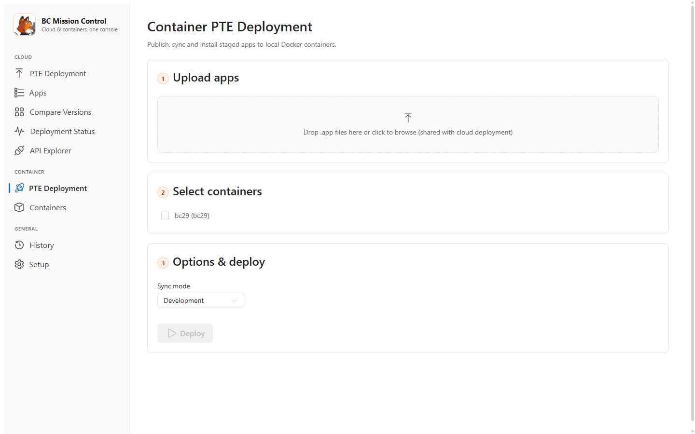

1. **Upload apps** — same box as cloud deployment; staged files are shared
   between both pages.
2. **Select containers** — tick the containers to deploy to.
3. Choose a **Sync mode** (*Development* is the usual choice).
4. Click **Deploy** and watch the live log.

### Containers

Map friendly names to Docker containers, set defaults, and create new
containers.

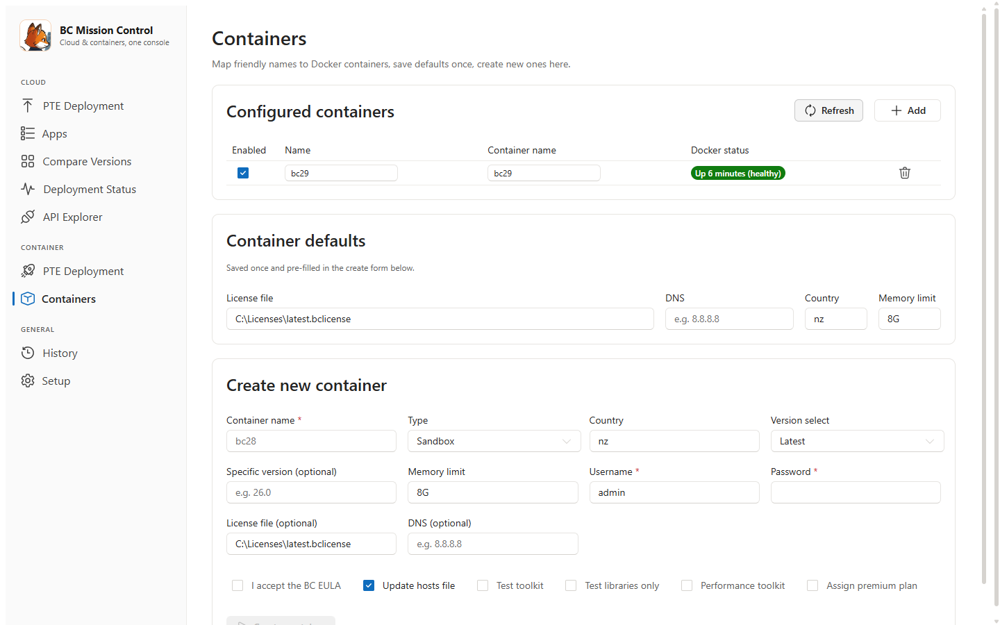

**Configured containers:**

1. Click **Add** to register an existing container: give it a friendly name and
   the real Docker container name.
2. Tick **Enabled** to make it available on the deployment page.
3. Click **Refresh** to see live Docker status (running, stopped, not found).

**Container defaults:** fill in your license file, DNS, country, and memory
limit once. The create form below pre-fills from these values.

**Create new container:**

1. Enter a **Container name**, **Username**, and **Password**.
2. Pick the **Type** (Sandbox), **Country**, and version.
3. Accept the BC EULA and choose any toolkits you need.
4. Click **Create**. Creation takes several minutes; the output streams on
   screen.

---

## History

Every run — cloud deploy, app update, environment create/copy/delete,
container deploy, container create — is saved here with its per-target results
and full log.

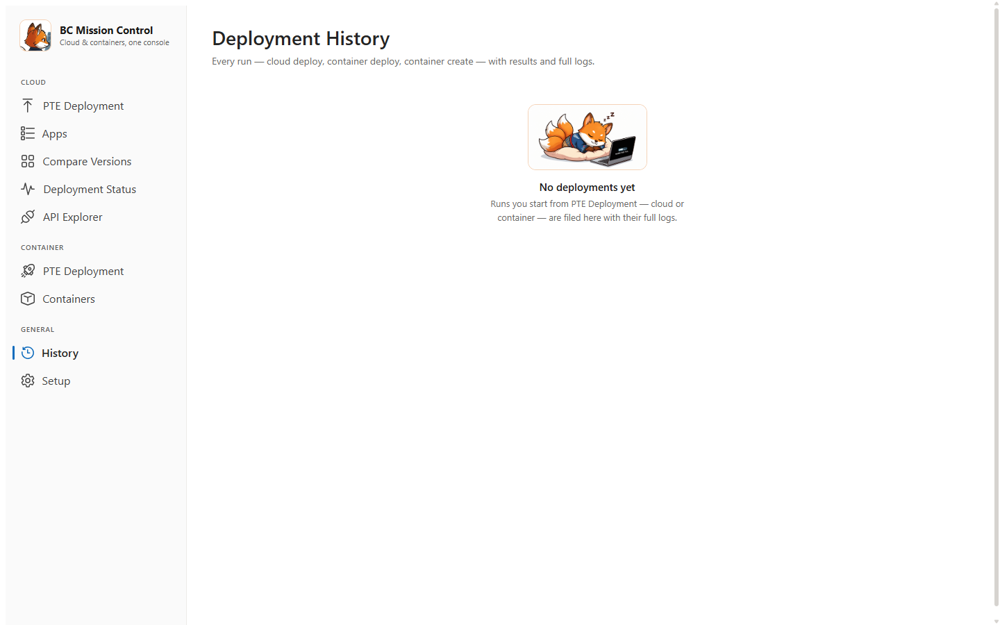

Use it to answer "what happened to that deployment last week?" without digging
through console windows.

---

## Troubleshooting

| Problem | What to do |
|---|---|
| `npm` or `node` is “not recognized” when running from source | Install the **LTS (Long Term Support)** version of [Node.js](https://nodejs.org/en/download). Then reopen the console and run `Start-MissionControl.bat` again. The EXE does not need Node.js. |
| The browser shows "can't reach this page" | Double-click `BCMissionControl.exe` again and keep its console window open. If you run from source, use `Start-MissionControl.bat` instead. Use the address shown in the console. |
| A page asks you to sign in again | Your token expired. Go to **Setup** → **Re-authenticate**. |
| "Load environments" fails | Check the Tenant ID is a valid GUID and your account has access to that tenant's Admin Center. |
| Container pages show errors | Make sure Docker Desktop is running, `pwsh` is on your PATH, and BcContainerHelper is installed (`Install-Module BcContainerHelper`). |
| Creating an environment fails with a storage error | You are over your storage quota. Check the **Storage** page, then free space or buy more capacity. |
| A deploy failed | Open **History**, find the run, and read its log. For cloud deploys also check **Deployment Status** for the server's error message. |

---

## Where your data lives

Settings, your sign-in token, and staged `.app` files are stored on your computer:

- **EXE:** `%APPDATA%\BCMissionControl`. Paste this path into File Explorer
  to open the folder.
- **Portable EXE:** if a `data` folder exists beside the EXE, the app uses
  that folder instead. Create it before your first run if you want this option.
- **Source code:** `server/data/` inside the source folder.

Keep this folder private and do not commit it to source control. When updating
a portable EXE, keep its `data` folder beside the replacement EXE.

Settings and sign-in data stay local. When you deploy an app, its `.app` file
is sent to the Business Central environment or container you selected.
