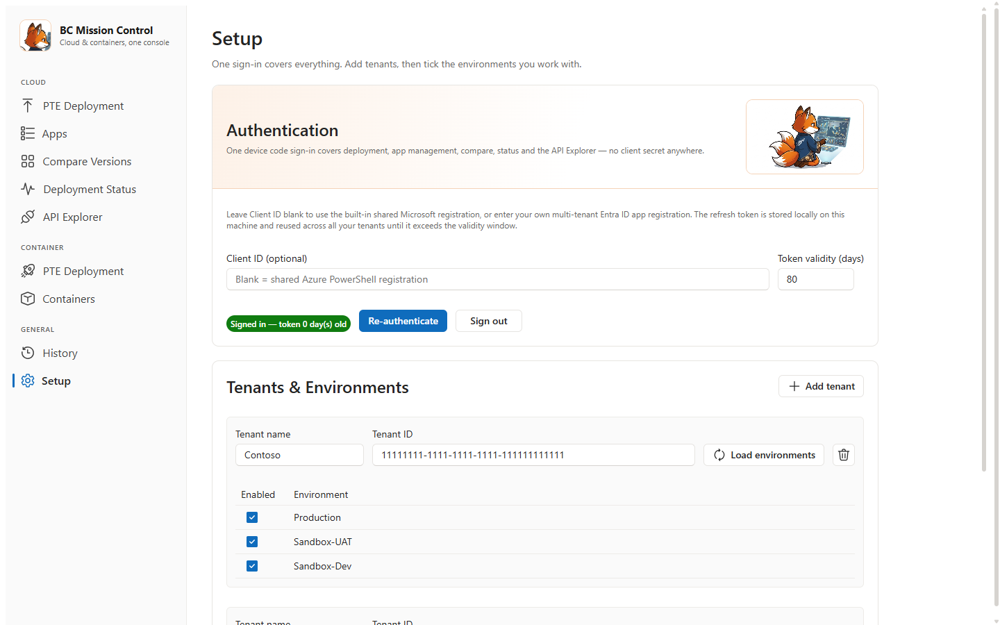
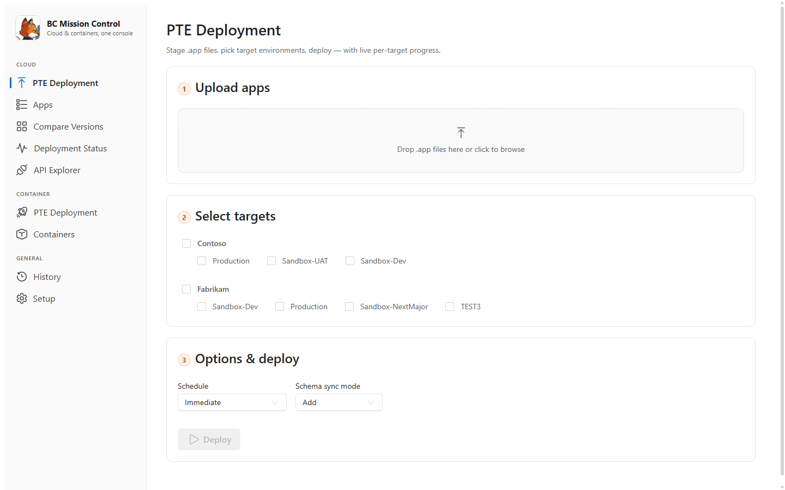
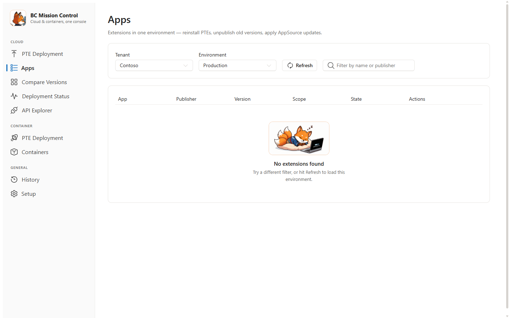
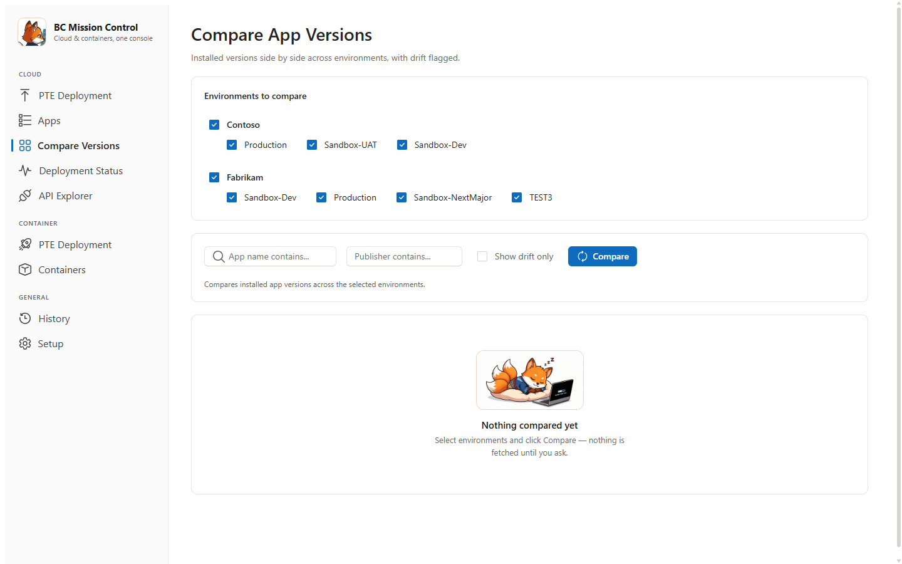
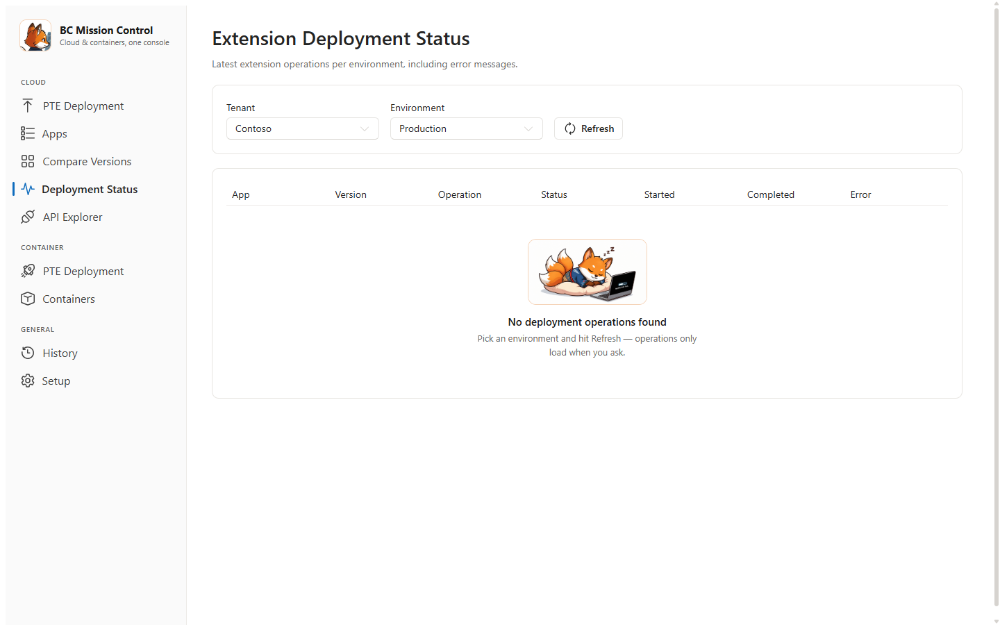
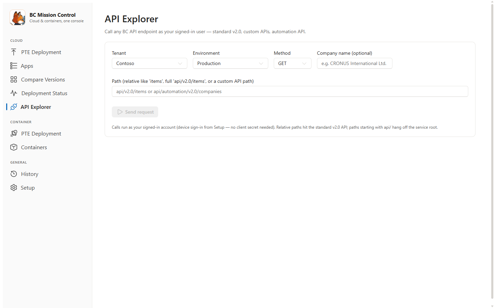
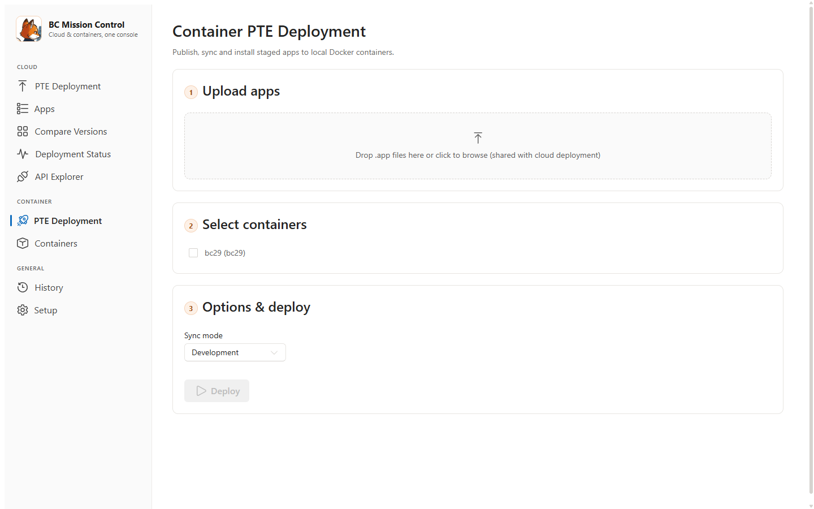
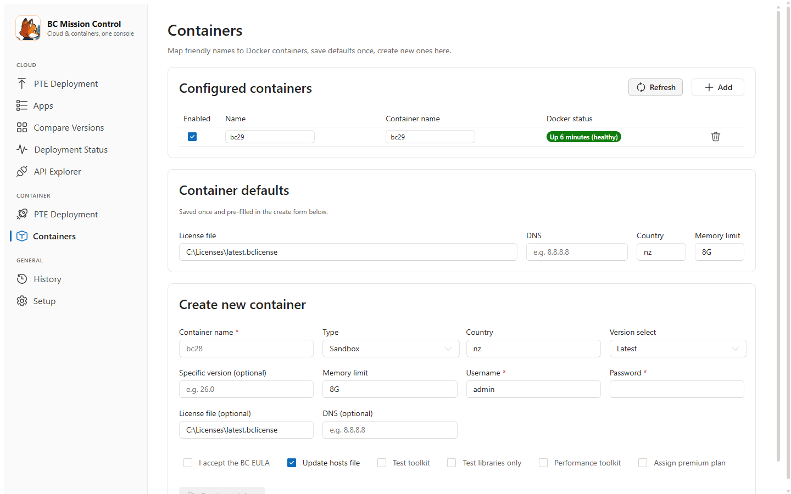
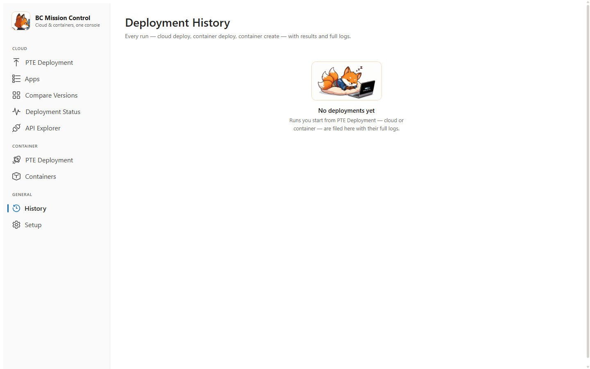

# BC Mission Control — User Guide

This guide shows you how to install, sign in, and use every page of BC Mission
Control — a local web app for managing Business Central (BC) cloud tenants and
local Docker containers from one place.

---

## What BC Mission Control does

BC Mission Control is a web page that runs on your own computer. It lets you:

- Deploy apps (`.app` files) to cloud sandboxes and production environments.
- See which app versions are installed in each environment.
- Compare versions across environments to spot differences.
- Call BC APIs directly from your browser.
- Create local Docker containers and deploy apps to them.

Nothing is sent to a third party. The app talks to Microsoft's Business Central
APIs directly, using your own sign-in.

---

## Start the app

1. Double-click **`Start-MissionControl.bat`** in the app folder.
2. Wait for the console window to finish installing and building (first run only).
3. Your browser opens at `http://127.0.0.1:4321`.

Keep the console window open while you use the app. Close it to stop the app.

> **Tip:** Run `Create-DesktopShortcut.ps1` once (right-click → Run with
> PowerShell) to get a desktop shortcut.

---

## Setup page — sign in and add tenants

Do this once, before anything else.

### Sign in

1. Open **Setup** (bottom of the left menu).
2. Leave **Client ID** blank to use the built-in shared Microsoft registration.
   Only enter your own Client ID if your company requires its own Entra ID app.
3. Click **Sign in with device code**.
4. A code appears. Click the link, enter the code, and sign in with your
   Microsoft work account.
5. Back in the app, you see a green **Signed in** badge.

One sign-in covers every page and every tenant. The app remembers you on this
computer until the token expires (default 80 days), then you sign in again.

### Add tenants and environments

1. Click **Add tenant**.
2. Enter a friendly **Tenant name** and the **Tenant ID** (a GUID from the BC
   Admin Center or Entra ID).
3. Click **Load environments**.
4. Tick the environments you work with. Unticked environments stay hidden from
   the rest of the app.

Soft-deleted environments are hidden automatically — the same as in the Admin
Center.

---

## Cloud section

### PTE Deployment (cloud)

Use this page to upload your own apps (PTEs — per-tenant extensions) to cloud
environments.

1. **Upload apps** — drag `.app` files into the box, or click it to browse. The
   app reads each file's name, publisher, and version automatically.
2. **Select targets** — tick the environments you want to deploy to.
3. **Options & deploy** — choose:
   - **Schedule**: *Immediate* installs now; *Update window* lets Microsoft
     install during the environment's maintenance window.
   - **Schema sync mode**: how table changes are applied. *Add* is the safe
     default; *Force Sync* can delete data in removed fields.
4. Click **Deploy**.

You see live progress per environment while it runs. Apps install in dependency
order automatically. Within one environment apps install one at a time;
different environments run in parallel.

### Apps

See every extension installed in one environment, with its scope
(PTE / Dev / AppSource) and state.

1. Pick a **Tenant** and **Environment**.
2. Click **Refresh** — nothing loads until you ask.
3. Use the filter box to find an app by name or publisher.

From the **Actions** column you can:

- **Reinstall** a PTE that was uninstalled.
- **Unpublish** an old PTE version.
- **Apply update** when a newer AppSource version is available.

### Compare Versions

Check that the same apps are on the same version everywhere.

1. Tick the environments to compare.
2. Click **Compare**.
3. Read the matrix: one row per app, one column per environment.
   - ✓ means all environments match.
   - ✗ means versions differ (**drift**). The highest version is highlighted.
4. Use **Show drift only** to hide apps that match everywhere.

### Deployment Status

See the latest app deployment operations in one environment, including error
messages when something failed.

1. Pick a **Tenant** and **Environment**.
2. Click **Refresh**.
3. Check the **Status** and **Error** columns for failures.

### API Explorer

Call any BC API endpoint and see the raw response — handy for checking data
without opening Postman.

1. Pick a **Tenant** and **Environment**.
2. Optionally enter a **Company name**.
3. Choose the **Method** (GET, POST, ...).
4. Enter the **Path**:
   - Short form like `items` calls the standard v2.0 API.
   - Full form like `api/v2.0/items` or a custom API path hangs off the
     service root.
5. Click **Send request**. The formatted response appears below.

Calls run as your signed-in user, so you only see data your account can see.

---

## Container section

These pages manage local Docker containers. They need **Docker Desktop**,
**PowerShell 7** (`pwsh`), and the **BcContainerHelper** module installed.

### PTE Deployment (containers)

Publish, sync, and install your apps into local containers.

1. **Upload apps** — same box as cloud deployment; staged files are shared
   between both pages.
2. **Select containers** — tick the containers to deploy to.
3. Choose a **Sync mode** (*Development* is the usual choice).
4. Click **Deploy** and watch the live log.

### Containers

Map friendly names to Docker containers, set defaults, and create new
containers.

**Configured containers:**

1. Click **Add** to register an existing container: give it a friendly name and
   the real Docker container name.
2. Tick **Enabled** to make it available on the deployment page.
3. Click **Refresh** to see live Docker status (running, stopped, not found).

**Container defaults:** fill in your license file, DNS, country, and memory
limit once. The create form below pre-fills from these values.

**Create new container:**

1. Enter a **Container name**, **Username**, and **Password**.
2. Pick the **Type** (Sandbox), **Country**, and version.
3. Accept the BC EULA and choose any toolkits you need.
4. Click **Create**. Creation takes several minutes; the output streams on
   screen.

---

## History

Every run — cloud deploy, container deploy, container create — is saved here
with its per-target results and full log.

Use it to answer "what happened to that deployment last week?" without digging
through console windows.

---

## Troubleshooting

| Problem | What to do |
|---|---|
| The browser shows "can't reach this page" | Start the app again with `Start-MissionControl.bat` and keep the console window open. |
| A page asks you to sign in again | Your token expired. Go to **Setup** → **Re-authenticate**. |
| "Load environments" fails | Check the Tenant ID is a valid GUID and your account has access to that tenant's Admin Center. |
| Container pages show errors | Make sure Docker Desktop is running, `pwsh` is on your PATH, and BcContainerHelper is installed (`Install-Module BcContainerHelper`). |
| A deploy failed | Open **History**, find the run, and read its log. For cloud deploys also check **Deployment Status** for the server's error message. |

---

## Where your data lives

All settings, your sign-in token, and uploaded `.app` files are stored in the
`server/data/` folder on your computer. Nothing is uploaded anywhere else.
Keep this folder private and do not commit it to source control.
